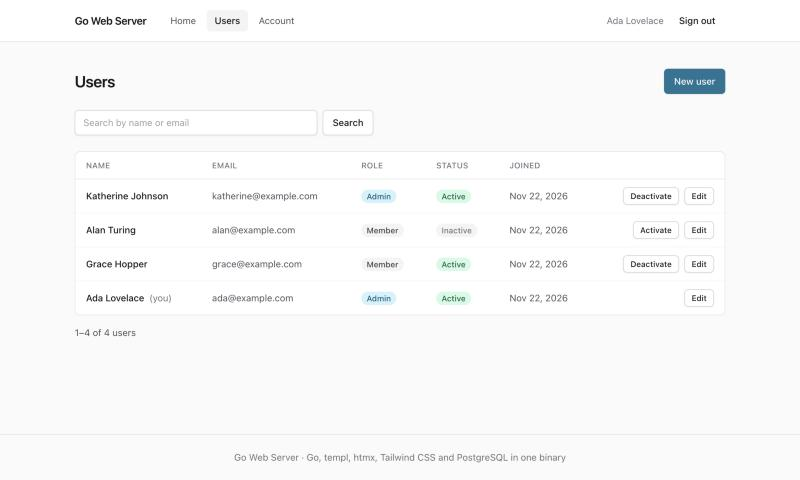

# go-web-server

[](https://github.com/dunamismax/go-web-server/actions/workflows/ci.yml)
[](https://github.com/dunamismax/go-web-server/releases/latest)
[](go.mod)
[](LICENSE)

A starting point for server-rendered web applications in Go. It ships with
sign-up and sign-in, role-based access, an admin screen, a PostgreSQL
database with migrations, and a test suite that runs against a real database.
Everything compiles into one static binary.

The whole toolchain is Go. There is no Node.js, no bundler and no
`node_modules`.



## The stack

| Concern | Choice | Why |
| --- | --- | --- |
| HTTP | [`net/http`](https://pkg.go.dev/net/http) | The standard library router has had method and wildcard patterns since Go 1.22. There is no framework to upgrade or outgrow. |
| HTML | [templ](https://templ.guide) | Components are type-checked and compiled to Go. A misspelled field fails the build instead of rendering blank. |
| Interactivity | [htmx](https://htmx.org) 2 | Search-as-you-type and in-place updates from HTML attributes. Every page also works with JavaScript turned off. |
| CSS | [Tailwind CSS](https://tailwindcss.com) 4 | Compiled by the standalone CLI, which the Makefile downloads and checksum-verifies. |
| Database | PostgreSQL via [pgx](https://github.com/jackc/pgx) | The native driver and connection pool. |
| Queries | [sqlc](https://sqlc.dev) | You write SQL; it generates type-safe Go. No ORM. |
| Migrations | [goose](https://github.com/pressly/goose) | Plain SQL files embedded in the binary, applied at startup or with `server migrate`. |
| Sessions | [scs](https://github.com/alexedwards/scs) | Server-side sessions stored in PostgreSQL, so sign-outs and deactivations take effect immediately. |
| Passwords | Argon2id | Via `golang.org/x/crypto`, in the standard PHC format, with automatic upgrades when the parameters are raised. |
| CSRF | `http.CrossOriginProtection` | The standard library's token-free defense (Go 1.25+). Forms need no hidden fields. |
| Config | Environment variables | Parsed into a typed struct by [caarlos0/env](https://github.com/caarlos0/env). |
| Logging | `log/slog` | Structured logs: text in development, JSON in production. |
| Tasks | `make` | One Makefile pins every tool version for local runs, CI and Docker alike. |

## Quick start

This is a GitHub template repository: **Use this template** on the repository
page gives you your own copy to start from.

You need Go 1.27 or newer, `make`, and PostgreSQL. Docker is the easiest way
to get PostgreSQL but is not required.

```bash
git clone https://github.com/dunamismax/go-web-server.git
cd go-web-server
make setup     # downloads Go modules and the Tailwind CLI, creates .env
make db-up     # starts PostgreSQL 18 in Docker
make dev       # runs the app with live reload
```

Open <http://localhost:7331> and create an account. The first account on a
fresh database becomes the administrator.

`make dev` proxies the app through port 7331 so the browser reloads when you
save a `.go`, `.templ` or CSS change. The app itself listens on port 8080.

**Port 5432 already in use?** Start the database on another port with
`DB_PORT=5433 make db-up` and change the port in `DATABASE_URL` in `.env`.

**Prefer a PostgreSQL you already run?** Create a role and database, then
point `DATABASE_URL` in `.env` at them:

```bash
createuser --pwprompt gowebserver
createdb --owner gowebserver gowebserver
```

**Only want to look?** The generated code is checked in, so a fresh clone
builds with nothing but Go: `go run ./cmd/server` (with `DATABASE_URL` set).

## Everyday commands

Run `make help` for the full list.

| Command | What it does |
| --- | --- |
| `make dev` | Run with live reload |
| `make generate` | Regenerate sqlc, templ and CSS output after editing their sources |
| `make test` | Run every test with the race detector, including the PostgreSQL-backed ones |
| `make test-short` | Run only the tests that need no database |
| `make lint` / `make fmt` | Lint with golangci-lint / format Go and templ files |
| `make check` | Everything CI runs: generated-code check, lint, tests, vulnerability scan, build |
| `make build` | Build the production binary to `bin/server`, stamped with the Git version |
| `make migration name=add_widgets` | Create a new migration file |
| `make migrate` / `make migrate-status` | Apply migrations / show their state |
| `make docker` | Build the container image |

## What is in the box

- **Accounts.** Sign-up, sign-in, sign-out, a profile page and password
  changes. Changing a password signs out every other device.
- **Roles.** `admin` and `member`. Admins get a user management screen with
  search, pagination, create, edit, deactivate and delete. Admins cannot
  demote, deactivate or delete themselves, so there is always one left.
- **Security defaults.** A strict Content Security Policy with nothing
  inline, security headers, CSRF protection, rate-limited sign-in, hardened
  session cookies, and login responses that do not reveal which emails exist.
  See [docs/security.md](docs/security.md).
- **Operations.** `/healthz` and `/readyz` probes, graceful shutdown,
  request IDs in logs and on error pages, a distroless container image, and a
  sandboxed systemd unit with a Caddy example.
- **Tests.** Unit tests plus end-to-end tests that drive the real handler
  stack against a real PostgreSQL, each in its own throwaway schema.

## Project layout

```text
cmd/server/            Entry point: serve, migrate, healthcheck, version
internal/
  assets/              Embedded static files, and the Tailwind source
  auth/                Argon2id password hashing
  config/              Environment-variable configuration
  store/               Connection pool, migrations, queries, sqlc output
    migrations/        goose SQL migrations (the schema's source of truth)
    queries/           SQL that sqlc turns into Go
    storetest/         Isolated test databases
  view/                templ components and the data types that drive them
  web/                 Routes, middleware, sessions and handlers
deploy/                systemd unit, Caddyfile and production env example
docs/                  Architecture, development, security and deployment notes
```

[docs/architecture.md](docs/architecture.md) explains how the pieces fit and
why they are split this way.

## Configuration

All configuration is environment variables. In development the server also
reads a `.env` file, and real environment variables override it.
[`.env.example`](.env.example) documents each one.

| Variable | Default | Purpose |
| --- | --- | --- |
| `APP_ENV` | `development` | `production` switches to JSON logs, Secure cookies and HSTS |
| `HTTP_ADDR` | `:8080` | Listen address; falls back to `:$PORT` when unset |
| `DATABASE_URL` | required | PostgreSQL connection string |
| `DATABASE_MAX_CONNS` | `10` | Connection pool size |
| `DATABASE_AUTO_MIGRATE` | `true` | Apply pending migrations at startup |
| `LOG_LEVEL` | `info` | `debug`, `info`, `warn` or `error` |
| `LOG_FORMAT` | by environment | `text` or `json` |
| `SESSION_LIFETIME` | `168h` | How long a sign-in lasts |
| `SESSION_COOKIE_SECURE` | by environment | Force the cookie's `Secure` flag on or off |
| `TRUSTED_PROXIES` | empty | Proxies whose `X-Forwarded-For` is believed |
| `TRUSTED_ORIGINS` | empty | Extra origins allowed to send state-changing requests |
| `SHUTDOWN_TIMEOUT` | `15s` | Grace period for in-flight requests |

## Making it yours

1. Rename the module: `make rename module=github.com/you/yourapp`.
2. Change `AppName` in [`internal/view/view.go`](internal/view/view.go).
3. Add your own tables with `make migration name=...`, your queries under
   [`internal/store/queries/`](internal/store/queries/), and run
   `make generate`.
4. Add pages: a templ component in `internal/view`, a handler in
   `internal/web`, and a line in
   [`internal/web/routes.go`](internal/web/routes.go).

[docs/development.md](docs/development.md) walks through each of these.

## Testing

```bash
make db-up
make test
```

Tests that need PostgreSQL read `TEST_DATABASE_URL`, which `make test` points
at the `make db-up` database. Each test creates its own schema, migrates it,
and drops it afterwards, so tests run in parallel and never touch your
development data. Plain `go test ./...` skips those tests when the variable
is unset.

## Deploying

The build output is one static binary with the templates, styles and
migrations inside it. Two paths are documented in
[docs/deployment.md](docs/deployment.md):

- a container image (`make docker`, about 25 MB, distroless, non-root), and
- a Linux host with systemd and Caddy, using the files in
  [`deploy/`](deploy/).

## What is left out on purpose

These depend too much on the product to guess well:

- Email: verification, password reset and notifications
- Two-factor authentication and social sign-in
- A JSON API (the handlers render HTML; add API routes beside them if you
  need one)
- Metrics, tracing and background jobs
- Multi-instance rate limiting (the built-in limiter is per process)

## Upgrading from 4.x

Version 5 is a rewrite, not an in-place upgrade. If you built on 4.x, treat
5 as a reference rather than merging it. [CHANGELOG.md](CHANGELOG.md) has the
full list.

| 4.x | 5 |
| --- | --- |
| Echo v4 | Standard library `net/http` |
| Tailwind and DaisyUI built with npm | Tailwind 4 from the standalone CLI; no Node.js |
| Custom CSRF token middleware | `http.CrossOriginProtection` |
| Atlas migrations plus a startup schema bootstrap | goose migrations embedded in the binary |
| Mage | Make |
| koanf (YAML, `.env` and environment) | Environment variables only |
| Air | `templ generate --watch` |
| GoReleaser packaging | A Dockerfile and a systemd unit |
| Any signed-in user manages all users | `admin` and `member` roles |

The database schema starts over with a single migration, the routes moved
(`/auth/login` is now `/login`, `/profile` is now `/account`, `/health` is
now `/healthz` and `/readyz`),
and the environment variable names changed. See
[`.env.example`](.env.example).

The Astro + Vue frontend and JSON API that were on `main` between 4.0.0 and
5.0.0 were never released and are not part of 5.

## License

[MIT](LICENSE)
